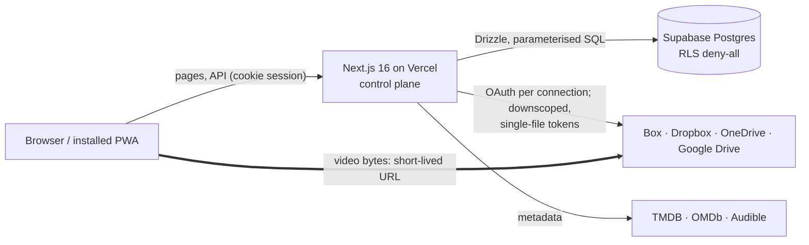

<p align="center">
  
</p>

<p align="center">
  <strong>A private, multi-tenant media server in the cloud.</strong><br>
  Movies, TV, audiobooks, music, eBooks, and a Google&nbsp;Photos-style library, streamed straight from your own Box, Dropbox, OneDrive or Google&nbsp;Drive.
</p>

<p align="center">
  
  
  
  
  
  
</p>

---

## What it is

Roam is a Plex-style media server with two deliberate departures:

1. **The storage is your own cloud drive, not a NAS.** Each server connects its *own* Box, Dropbox, OneDrive or Google Drive account (as many as it likes) over OAuth, and the browser streams video **directly from the provider** using short-lived, single-file download URLs. There are no media servers to run.
2. **The app is a stateless control plane on Vercel's free tier.** It handles auth, metadata, access control, and URL minting, and it is built so that it never has to move video bytes (Google Drive can stream through a free Cloudflare Worker, so even that stays off Vercel) or transcode.

It is a real, working product, not a tutorial project: it has accounts, per-person profiles with age limits, shareable libraries, resumable playback, offline downloads, playlists, a TV app, and photo browsing with a few-thousand-photo timeline. This README is written for people evaluating the engineering, so it leads with the interesting problems.

> **Status:** in daily use by a small group of people. The code is public to read ([see the license](#license)), and a [public demo server](#public-demo) lets you try it without an account or any setup.

## Engineering highlights

### Seamless multi-file playback
Movies ripped as `Part 1` / `Part 2` (and combined multi-episode files) play as **one continuous video**. A custom dual-`<video>` player preloads the next segment on a second element and swaps at the boundary, tracks a single virtual timeline across files, handles trims for combined episodes, and refreshes expiring storage URLs mid-playback. Position is saved per profile.

### Metadata and codecs without ffmpeg on the hot path
Duration, codecs, chapters, and cover art are read with **hand-written, bounded parsers** that fetch only a few KB with HTTP range requests (MP4/MOV atoms, MP3 ID3v2.2–2.4 + ID3v1, EXIF/TIFF, HEIC/HEIF boxes, JPEG/PNG/GIF/WebP headers). A scan never downloads a whole file.
Because these parse **untrusted files**, every read is range-checked, loops and allocations are capped, impossible dates and dimensions are rejected, and the parsers are covered by seeded fuzz tests that must never throw or hang.

### Scanning that is safe to run against someone's library
- **Time-budgeted and resumable.** Vercel Hobby caps functions at 60 s, so scans work in single-transaction slices with a resumable depth-first cursor, and pick up automatically on the next page load.
- **Cleanup that can't wipe a library.** Files removed from storage are pruned only after a *clean* scan cycle, each candidate is verified against the provider by id, a grace period applies, and a hard cap refuses to delete when the number looks like an outage or a wrong folder.
- One scan engine drives every library kind through a small "profile" object (what a file becomes, what is probed, what is read). A library can span folders on several connections and providers; if one is signed out the others still scan.

### Multi-tenancy and access control
- Anyone can sign up; they then create or join a **server**. One admin per server; invites are viewer-only (an admin can delete a server, a library or an invitation; expired invitations drop out of the list after a week).
- **Per-library sharing**: a library is visible to everyone on the server or to chosen accounts only. A single choke point (`libraryVisible`) is used by every reader, and a test walks the source tree to enforce it.
- **Profiles with age limits** (Netflix-style): content is filtered in SQL, before ordering and paging, so a hidden item can't leak through a count, a cursor, or a "next" button.
- Every refusal (missing, hidden, age-blocked, wrong kind) is the **same 404**, so nothing confirms an item exists.
- Storage tokens are **AES-256-GCM encrypted at rest**; Postgres row-level security is deny-all (the app is the only client); sign-up and heavy routes are rate-limited in Postgres.

### A photo library that scrolls like Google Photos
- **The whole timeline is laid out up front.** Month counts give every block its exact pixel height, and blocks fill as they near the screen. Scrubbing to any month is just a scroll: nothing is inserted above you, no scroll-correction hacks.
- A viewer that opens as an **overlay** (instant close, scroll position untouched), with pinch/double-tap zoom, swipe between items, swipe-down to close, and neighbours that slide in with the finger.
- Dates: a picture is dated by its own EXIF time, else by a date in its file name (`IMG_20190314_142530.jpg`, `Screenshot_2019-03-14-14-25-30.png`, `2019-03-14 14.25.30.jpg`, a Unix time in milliseconds, or a bare date, which counts as noon), else by when it reached the storage. An admin can set the date by hand (**Info → Change date…** in the viewer): it is saved in Roam at once and never replaced by a scan, and where Roam can write to the storage (Box) and the file is a JPEG, it is also written into the file's EXIF as a new version of the Box file (the earlier version stays in Box's history; the picture data is untouched). Other formats and storage services keep the date in Roam only, and the viewer says so. `scripts/finish-photo-scan.ts` finishes a big library's date reading from this computer; `scripts/backfill-name-dates.ts` applies file-name dates to pictures read earlier.
- EXIF dates and HEIC support, a month scrubber that scrolls live, favorites per profile, search by name or date, and day/month/year zoom levels.
- Thumbnails and previews are proxied through one access-checked gate with private caching; no image is stored in the database.
- **New photos show up when you open the library.** The photos already known are drawn first; then a quick look for new pictures and videos runs from the newest forward (a thin bar and "Looking for new photos…" at the top), and anything found is put in without moving the page: the date you were looking at stays where it is, even when photos are added above it. Pulling down at the top of the timeline (on a touch screen) does the same look. The look (`POST /api/libraries/{id}/photos/refresh`, any member who can see the library, one at a time per library) lists the top of the library, follows the path down to the folders the newest photos are in, and walks any folder it hasn't seen before in full, so a new month or day folder is found; photos put into an old folder none of the newest are in wait for the next full scan.

### Honest handling of what browsers can't play
Roam deliberately does no server-side transcoding. For files whose audio browsers can't decode (AC-3, E-AC-3, DTS) it detects the codec during the scan and offers a **remux** (video copied, audio to AAC; Box storage) as a separate "browser-friendly" file linked to the original. A video the device can't decode (HEVC on a browser without it) is refused up front instead of spinning, and the player picks a version the device can play. For phone videos (HEVC) in photo libraries it uses **Box's own H.264 rendition**, handed to the browser behind a token scoped to a single file.

## Architecture



Video bytes never pass through Vercel, except Google Drive's when no Cloudflare Worker is set up (Drive has no per-file download links). Photo thumbnails and previews do (small, cached, and gated by the same access check as everything else).

## Public demo

You can try Roam as a guest, with no email or password: open the demo link, press **Continue as a guest**, and you're browsing a demo server.

**Demo link:** <https://roam-three-gray.vercel.app/join/9XZLaau-Tl9bxfQLQ7Ggy2qdRESKx_UQ>

What to know before you click:

- **Some of it is placeholder.** The demo's movies and shows have real, familiar names, and their posters, descriptions and ratings come from TMDB, but every video is a 45-second clip cut from one of two openly licensed films (Big Buck Bunny and Sintel, Creative Commons Attribution 3.0). In the same way, the albums by famous artists carry real titles, track lists and covers (from MusicBrainz) but 40-second clips of CC0 Chopin recordings, and the J.R.R. Tolkien books (still in copyright) are placeholder EPUBs with public-domain text. None of it is the work named. A banner says so on every page, and the credits page lists each source, its author and its licence. The photos, Chopin recordings, LibriVox audiobooks and Project Gutenberg books are real, openly licensed material, shown as what they are.
- **You're a viewer, and invisible.** A guest can watch and make their own playlists and favorites; they can't change anything, can't create servers, and other visitors can't see them. Guest accounts are deleted after about a week without a visit.
- **It has a daily play limit.** The videos stream from a real Box account, so the demo allows a fixed number of plays per day across all visitors. If it's "resting", come back tomorrow.

How it's built (the interesting part, for reviewers): a server's admin can switch on an **open join link** that only ever adds a *viewer* (a database rule makes a second admin impossible, and joining never changes an existing member's role). Guests are real accounts created with Supabase's anonymous sign-in, flagged as guests, hidden from other members from the first moment, refused anything that spends the owner's API quota, and cleaned up by a routine that deletes in dependency order and re-checks inactivity inside the transaction. Per-account limits are meaningless when accounts are free, so the real cost cap is a daily total for the whole demo, recorded against the server's owner.

## Tech stack

| Area | Choice |
|---|---|
| Framework | Next.js 16 (App Router, Server Components, route handlers, `proxy.ts`), React 19, TypeScript |
| Data | PostgreSQL on Supabase, **Drizzle ORM**, 48 migrations (enum changes split from their first use, additive-first) |
| Auth | Supabase Auth (magic link, Google, email + password), custom roles, profiles |
| Storage | Box, Dropbox, OneDrive, Google Drive behind one `StorageProvider` interface (OAuth 2 with rotating refresh tokens, byte-range reads, signed single-file stream links; optional Cloudflare Worker for Drive) |
| UI | Tailwind CSS 4, shadcn/Base UI, Lucide, installable PWA |
| Metadata | TMDB (kept once in a shared cache, refreshed within six months), OMDb, Audible, MusicBrainz, OpenSubtitles (all optional or fully offline for "generic" libraries) |
| Tests | **Vitest** with in-memory Postgres (**PGlite**) replaying the real migrations; ~2,000 tests |
| Hosting | Vercel (Fluid compute) with a Postgres-backed rate limiter and no extra services |

## Quality and testing

- Tests run against a **real Postgres engine in memory** with the production migrations, so constraints, locks, indexes, and cursor ordering are exercised, not mocked.
- Security-relevant guards (library access, age filtering, uniform 404s, kind allow-lists, rate limits) each have a test that was checked to **fail when the guard is removed** (manual mutation testing).
- Source-level enforcement tests fail the build if a new reader skips the access helper or a new code path special-cases a library kind with a string literal.
- Every feature went through plan → independent review → small commits → independent review again; the commit history reflects that.

## Feature guides

### Storage, connections and library folders

A server can have any number of **storage connections** (Server settings > Storage): Box, Dropbox, OneDrive and Google Drive, several accounts of the same kind if you like. A library is made of one or more **folders**, each on any connection; a scan treats them as one library (folders of the same name merge, and if one connection is signed out the others still scan, with the problem reported). Add or remove a library's folders under it in Server settings.

Each kind of storage needs the deployment to hold its sign-in keys, or it isn't offered:

- **Box:** `BOX_CLIENT_ID`, `BOX_CLIENT_SECRET`.
- **Dropbox:** `DROPBOX_APP_KEY`, `DROPBOX_APP_SECRET`. Create an app at dropbox.com/developers/apps with *Scoped access* and *Full Dropbox*, tick `files.metadata.read` and `files.content.read` on its Permissions tab, and add `https://<your site>/api/dropbox/callback` as a redirect URI. Dropbox streams through temporary direct links (good for four hours), so nothing passes through Roam.

- **OneDrive** (personal, work or school): `MICROSOFT_CLIENT_ID`, `MICROSOFT_CLIENT_SECRET`. Register an app at portal.azure.com (App registrations), supporting *any organizational directory and personal Microsoft accounts*, with the Web redirect URI `https://<your site>/api/onedrive/callback`; create a client secret (they expire, at most after 24 months, so note when); give it the Microsoft Graph delegated permissions `Files.Read.All`, `User.Read` and `offline_access`. OneDrive streams through each file's own pre-authenticated link (good for about an hour).

- **Google Drive:** `GOOGLE_CLIENT_ID`, `GOOGLE_CLIENT_SECRET`. In Google Cloud Console create a project, enable the *Google Drive API*, configure the OAuth consent screen (External; add the `.../auth/drive.readonly` scope; **publish it to "In production"** so logins don't expire after 7 days; Google shows an "unverified app" warning that you click through, and caps it at 100 users, which is plenty for a private server), then create an *OAuth client ID* of type *Web application* with the redirect URI `https://<your site>/api/google/callback`. Google has no per-file download links, so Drive files stream *through Roam* (`/api/storage/stream/<token>`, a signed link for one file that expires in four hours); the account's own token never reaches a browser. That means Drive playback uses your hosting's bandwidth, unlike Box, Dropbox and OneDrive. Only files in My Drive and shared drives can be browsed (not "Shared with me": add a shortcut-free copy or move them into a folder you own). Needs `NEXT_PUBLIC_APP_URL` set to the site's address. To take that load off your host, deploy the free Cloudflare Worker in `cloudflare/stream-worker/` (see its README) and set `STREAM_WORKER_URL` and `STREAM_SECRET`: Drive playback then streams through Cloudflare, which charges nothing for bandwidth (the free plan allows 100,000 requests a day).

Things only Box does: making browser-friendly copies of unsupported audio (remuxing), Box's own previews of phone videos, and putting a TMDB tag in a folder's name.

### Cast and crew

A movie's or show's page shows its billed cast and its key crew (directors, writers, producers, composer, cinematographer, editor) from TMDB, as rows of photos. Click a person to see their movies and shows on this server, with what they did on each (their role, or "Director"). Only what the viewer is allowed to see is listed. A person's page also shows their biography (from TMDB) above their titles, and a "Not on this server" section with their other well-known work, which opens on The Movie Database; a profile with an age limit doesn't get that section, since TMDB's credits carry no ratings to check against. Cast and crew are fetched during library scans for every title with a TMDB match; Resync on a title fetches them again.

### Audiobook authors and credits

An audiobook library has a **Books | Authors** switch. Authors shows each author as a tile (their cover, and how many books); opening one shows everything that person is credited with on the server. A book's page has a **Credits** row with its authors and narrators (a full-cast recording lists them all, labelled Cast when there are more than three), and clicking anyone opens their page: the books they wrote and the books they narrated, in series order. People are matched by name, ignoring case and spacing, across all the audiobook libraries the viewer can see.

### TMDB data and its six-month rule

TMDB's terms ask that what Roam keeps from it be refreshed at least every six months. Everything from TMDB (details, ratings, cast, crew, episodes) is kept once in a shared cache (`tmdb_entries`, `tmdb_cast`, `tmdb_crew`) that every server reads, so a movie two servers have is fetched once. Titles and episodes still carry copies of what lists and filters need (poster, description, age rating), pushed from the cache whenever it refreshes. Entries are refreshed when they are about five months old: when someone opens that movie or show (the page waits a moment for it, at most four seconds), and by a daily job (`/api/cron/refresh`, scheduled in `vercel.json`, needs `CRON_SECRET` set in the project's environment) that works through the oldest first and forgets entries no title uses. An entry that couldn't be refreshed within six months (TMDB unreachable, or the item removed) is cleared: its description, pictures, genres, cast and crew disappear from the titles that used it, while the age rating stays so a restricted title is never opened up. Titles with no match, and admin-chosen matches, are refreshed the same way by their TMDB id.

### Chapters

Movies and episodes with chapters show them in three places: as marks on the player's progress bar (a drag or click near a mark snaps to it, and the hover label names the chapter), in a **Chapters** list on a movie's page and under each episode (click one to start playing there), and nowhere else. Where a multi-part movie's files join is not marked, unless a part has a chapter right there, which then shows as the chapter. Fewer than two chapters isn't shown.

Chapters come from two places:

- **Inside the file.** MP4, M4V and MOV files made by HandBrake, MakeMKV-then-remux, ffmpeg and similar carry chapters; Roam reads them during the scan (and reads the library you already have a little at a time on each scan, or all at once with `npx tsx --env-file=.env.local scripts/backfill-chapters.ts`). Chapters named only "Chapter 1", "Chapter 2" are shown as such.
- **A chapter file beside the video**, named like it with `.chapters` and an extension: `The Matrix (1999).chapters.xml`. It is used instead of what is in the video, and removing it goes back to the video's own. Three formats, all plain text:
  - `.chapters.xml`: Matroska chapter XML (what MKVToolNix exports and `mkvextract chapters` writes).
  - `.chapters.txt`: either the OGM simple format (`CHAPTER01=00:00:00.000` and `CHAPTER01NAME=Opening`, as `mkvmerge` reads) or one chapter per line, a time then a title (`0:00 Opening`, `1:02:30 The chase`).
  - `.chapters.vtt`: WebVTT, each cue's start the chapter's time and its text the title.

  A chapter file belongs to the one video file it is named after, with times from that file's start: a movie in parts gets one per part (`Movie - pt1.chapters.txt`), and each resolution version its own. It is found on the next scan of the library, or Resync on the movie. There is no online source of chapter times that Roam can use (TMDB has none).

### Skip intro, recap and credits

Episodes (and the occasional film) get **Skip intro**, **Skip recap** and **Next episode** buttons over the corner of the picture while those parts play: the button appears as the part starts and jumps to its end; during the credits it becomes **Next episode** (or **Skip credits** when there is no next one). With no credits time known, **Next episode** still appears for the last 25 seconds of an episode that has one after it. On a TV the button shows the same way and **OK** presses it.

- **Where the times come from.** [SkipDB](https://skipdb.tv), an open, crowdsourced database (data under the ODbL; the buttons carry its credit). Roam asks for them live when something is played (by the show's IMDb id, the season and episode, and the video's length, so a copy of a different length is matched), shows them and keeps no database of them (only a short-lived memory), which is all its terms ask of a service that only displays skip times. A title it has nothing on simply has no buttons; if it can't be reached in a moment, playback is not held up. In a sample of a dozen of this library's episodes most had intro and credits times; films rarely do. `SKIPDB_URL=off` turns it off.
- **Your own times.** A server's admin can mark them in the player: the flag button, then **Skip buttons**: press **Scene starts here** and **ends here** at the part, say which it is (intro, recap, credits, next-time preview) and save. They are kept in Roam, one time per part per video, and used instead of SkipDB's for the same part (SkipDB is not even asked once all four are marked). SkipDB's times are never copied into them or compared with them.
- **Found from the sound.** For shows SkipDB has nothing on, `npx tsx --env-file=.env.local scripts/detect-intros.ts --dry-run`, then `--show "Psych" --season 2` or `--limit 5` finds the opening titles and closing credits itself: it listens to the first eight and last seven minutes of each episode of a season (ffmpeg reads just that stretch from your storage, through a small server on this computer only, since the ffmpeg that ships with Roam crashes on https addresses), makes a fingerprint of each, and takes the stretch they keep sharing at about the same place. A season needs at least three episodes; the opening must be 15 to 200 seconds and the credits must run to the end of the episode. Only the times are kept (no audio), on every version of the episode, and they are used for **Skip intro** and **Next episode** only where neither a time marked by hand nor SkipDB's has one for that part (and the button carries no SkipDB credit for them). Real audio check: seven episodes of one season took about a minute and a half and gave the same 22-second theme in six of them. Roughly 60 MB is read per episode; re-running skips seasons already done (`--force` does them again).
- **Skip by itself.** Under Profiles > Edit > **Skip automatically**, each profile can choose intros, recaps, next-time previews and credits (which goes to the next episode). Off by default. Each part is skipped once per play, as it starts; going back into it is the viewer's choice.

### Content filtering and the parental guide

A profile can choose scenes to skip while watching. Under **Profiles > Edit > What to skip**, each of eleven categories (violence, language, sex, nudity, fear, drugs and alcohol, discrimination, commercial content, dispensable scenes, and, for what Does the Dog Die reports, animal harm and distressing themes) can be left alone, or skipped from a strength up (strong; moderate and up; everything, even mild). Who can change it follows the profile roles: the account owner for any profile, an admin profile for itself, and a limited profile not at all, so a limit set for a child sticks. Nothing is copied or edited, and nothing is announced: the player quietly jumps over the scene as it plays, or, for a cue about the sound only (a swear word), mutes it. The progress bar and the times measure the film without the skipped scenes (so it ends sooner), and chapter marks and seeking follow it.

**Before you watch.** When a movie or an episode has scenes the profile does not already skip entirely, its Play button first asks what else to skip for this viewing: each category in it, with the choices stricter than the profile's own. The profile's skips always apply, the picks apply to that play only (they are not saved, and carry on to the next episode of the same sitting), and the dialog is skipped when there is nothing to choose.

The scenes come from **Movie Content Filter** files (`.mcf`, [specification](https://www.moviecontentfilter.com/specification)): WebVTT where each cue is a time range and lines like `violence=high` or `language=medium=audio # note`. Put one beside the video, named like it: `The Matrix (1999).mcf`. Like chapter files, it belongs to the one video file it is named after, with times from that file's start (a movie in parts gets one per part, `Movie - pt1.mcf`), and is found on the next scan of the library or Resync on the movie. Removing the file removes its scenes. A video with no file is simply never filtered. The times are those of the cut the file was made for: a different cut will be off.

A movie's page shows a **Parental guide** built from its file: per category, the strongest level, how many scenes and how long, with the ones your profile skips marked. Every movie with an IMDb page also links to its parents guide on IMDb (there is no IMDb data feed Roam can use, and TMDB has content tags for only a small share of titles, none for the US). Scenes can also come from Does the Dog Die (below).

#### Does the Dog Die (optional)

[Does the Dog Die](https://www.doesthedogdie.com) is a community database of content warnings ("a dog dies", "there are jump scares"), some with the moment they happen. Roam can use it through its API, under their [API Terms of Service](https://www.doesthedogdie.com/api), which you accept yourself:

- **One key, held by whoever runs the deployment.** Set `DDD_API_KEY` (from your profile page on their site). Their terms don't allow sharing a key with another person, so Roam never takes a key from a server admin; people who run their own copy of Roam use their own. The free tier is **non-commercial only** (no charging, no ads or affiliate income, not for a business), 30 requests a minute and 5,000 a month; DDD may start charging at any time.
- **You decide which servers use it.** On the platform admin page each server is Off (the default), Limited (asked when someone is about to play a title) or Full (also asked when its page opens). Nothing is ever asked in bulk or ahead of need, and a title costs two or three requests once: what is learned is kept for 25 days, shared by every server, and never used past 30 (their rule), then deleted by the daily job. The page shows how much of the month's allowance is used; Roam stops asking at 90% and plays without it until the month turns over.
- **What it adds.** On a movie's page, a "What the community reports" list and the Parental guide's categories (marked as reported by the community, with no strength, since reports carry none); in the before-you-watch dialog and in playback, reported scenes that have both a start and a "safe to carry on" time, widened by a couple of seconds, are skipped for profiles that chose that category. Only community data is used (the free tier has none of their paid "Scene Alerts").
- **If it can't be reached** (out of allowance, down), the film plays without it and says so once. Their times fit one cut of a film, so skips can be a little off on a different rip.
- **Credit and caution.** Wherever their data shows, so does "Powered by DoesTheDogDie.com" (linked) and a reminder that the reports are unverified and may be incomplete. A topic is only a category you can skip if its name matches a rule in `src/lib/ddd/mapping.ts`; the rest still appear as reports.

#### Marking scenes yourself

A server's admin can mark scenes while watching: the flag button in the player opens a panel where **Scene starts here** and **Scene ends here** take the moment you are at, you say what it is (one of the format's nine categories), how strong, and whether to mute only the sound, then save. The marked scenes are listed, can be jumped to and deleted, and act from the next play. Where Roam can write to the video's storage (Box, which it already uses to save new versions), a scene file named like the video (`Movie (2020).mcf`, one per part for a movie in parts) is written or updated beside it, so the marks live in a standard file you can keep and share, and Roam reads them back at once. Roam's other storage connections (Dropbox, OneDrive, Google Drive) are read-only on purpose, so there the marks are kept in Roam's database instead (and any scene file already beside the video is shown but can't be changed). Allowing writes there would take a wider permission on each connection and is not done.

#### Profanity mutes from subtitles

Roam can mute the words a film's subtitles say, from a list of words in three strengths (mild, moderate, strong), as sound-only "language" scenes that follow each profile's Language choice. A word is placed within its subtitle line by where it sits in the text and the mute is widened a little (more for a long line), so it is close, not frame-exact. Only the mute times are kept, never the subtitle text.

- **A subtitle file beside the video** (`Movie (2020).srt`, or `Movie (2020).en.srt`; a "forced" file or another language is ignored) is read on the next scan of the folder or Resync. Removing the file removes its mutes.
- **From OpenSubtitles, a few at a time.** `npx tsx --env-file=.env.local scripts/build-language-filters.ts --dry-run`, then `--limit 20` (it needs the `OPENSUBTITLES_*` settings; each file takes one search and one download from the account's daily allowance, so a big library takes days: run it again after the allowance resets, and it carries on where it stopped). A subtitle is used only if it was made for this exact file (matched by OpenSubtitles' file fingerprint), because only then does its timing line up; files that are your own rips often match nothing. `--loose` accepts the best subtitle for the film when its length is about right, marked as a guess whose timing may be off (a different cut). Files already done, and ones that found no match, are skipped.

### Who owns what (copies, claims and playing at once)

For a server whose library is several households' discs pooled together. **Server settings > Who owns what** switches it on (off by default; nothing changes for a server that leaves it off).

- **Owners.** Each movie, audiobook or eBook can be owned by any number of households (accounts); a **show is owned one season at a time**. The admin can assign owners on a title's page, or many at once: in a library's **Select** mode, choose titles (or **Select all shown** after filtering) and press **Set owner**. Any member can press **I own a copy**. Each library's **Filters** has an **Owner** group (a household, or **No owner**) to find what is still unassigned. A title nobody has claimed yet stays watchable by everyone. Limited (child) profiles can't claim or withdraw.
- **How a claim is settled** is the admin's choice: **accepted straight away**, or **sent to the admin**, who can accept it, turn it down with a note, or **ask for evidence**: the person is told and can send up to three photos (shrunk to fit and shown only to the admin; deleted as soon as the claim is decided).
- **Withdrawing.** An owner can withdraw their copy and share it again, all or nothing for the whole server (never "some people but not others"). A title nobody is sharing can't be played by anyone but its owners, who can still play their own copy. While another owner still shares theirs, it plays as usual.
- **Playing at once** (optional, in the same settings, per kind of library). No more people can play a title at once than there are shared copies of it (a show counts per season; a profile counts once however many devices). Players send a heartbeat every 30 seconds; one that goes quiet for a minute and a half, or has been paused for ten minutes, lets go of its place. Someone turned away sees a waiting screen that retries every 20 seconds and starts the moment a copy is free, and can ask to be **told when it's free**.
- **Notifications.** A bell in the top bar (shown once there is something in it) lists claims to review, answers to your claims, and "free now" alerts. Phone and desktop push notifications are optional per device (on an iPhone or iPad, Roam must be added to the Home Screen first). Push needs three environment variables: generate the keys with `npx web-push generate-vapid-keys`, then set `VAPID_PUBLIC_KEY`, `VAPID_PRIVATE_KEY` and `VAPID_SUBJECT` (a `mailto:` address). Without them the bell works and push is simply unavailable.
- Music and photos aren't covered: a song or a photo isn't a copy of a title anyone claims.
- **On a TV** the title pages show who owns it with the claim, withdraw and share buttons, a blocked play says why (and OK asks to be told), notifications are a button on the home screen, and TVs hold their place for the limit. Assigning owners and settling claims stay on the web.

### Apps and the API

Native apps (TV apps, phone apps, Kodi) use a JSON API documented in [`docs/api.md`](docs/api.md). An app is signed in the way a TV is: it shows a short code, a person approves it at `/link` while signed in, and the app receives a **device token** (kept only as a hash; sent as `Authorization: Bearer`) that acts as that account and one chosen profile (a PIN profile asks for its PIN). Signed-in apps are listed, with a **Sign out** each, under *Manage profiles*. The token works with the older endpoints too (play, watch progress, playlists, ownership, notifications), so an app needs no cookies. The browse side (`/api/v1/servers/…`: home, libraries, items, titles, albums, artists, search) answers with the same sharing and age rules as the web.

### Roku

A Roku channel is in [`roku/`](roku/README.md) (BrightScript, using the same JSON API). `npx tsx scripts/package-roku.ts --url https://your-roam.example` builds the zip to install on a Roku in developer mode. It compiles under test but has not yet been run on a real Roku.

### Kodi

A Kodi add-on is in [`kodi/`](kodi/README.md) (Python, using the same JSON API): sign in with a code, browse, play with your place kept, scenes skipped or muted for the profile, and skip buttons. `npx tsx scripts/package-kodi.ts --url https://your-roam.example` builds the zip to install in Kodi. It is tested against stand-ins for Kodi but has not yet been run inside a real Kodi.

### Android, Android TV and Fire TV

One Kotlin app for phones, Android TV and Fire TV is in [`android/`](android/README.md) (Compose and Media3, using the same JSON API). **Downloads:** a movie or episode's page has a **Download** button (it asks which quality when there are several) that saves the video on the device; **Downloads** on the home screen (and the "Open downloads" button shown when Roam can't be reached) lists what is saved and plays it with no connection. A download runs while the app is open and starts over if the app is closed before it finishes; a saved video's place isn't reported back to Roam. Its 101 tests run on the JVM (Robolectric draws the real screens); tests that play a real video on an emulator are written and compile, but need hardware virtualization to run. Build with `./gradlew :app:assembleDebug` in `android/`.

### Xbox

A small UWP app in [`xbox/`](xbox/README.md) shows the TV interface (above) in a web view and passes the controller's buttons to it. It is built on a Windows machine by a GitHub workflow (`.github/workflows/xbox.yml`, run it from the Actions tab), which also runs its tests. It builds and passes its tests there but has not been run on a console.

### Trailers and extras

A movie's page lists its trailers and other extras when its folder has them, named the way Plex names them. Either put the type at the end of the file name, right after a hyphen (`Teaser-trailer.mp4`, `Making Of-behindthescenes.mp4`, `Cut Scene-deleted.mp4`, `The Look-featurette.mp4`, `Talk-interview.mp4`, `Opening-scene.mp4`, `Little Film-short.mp4`, `Misc-other.mp4`), or put the videos in a subfolder of the movie's folder named for the type (`Trailers`, `Behind The Scenes`, `Deleted Scenes`, `Featurettes`, `Interviews`, `Scenes`, `Shorts`, `Other`). They are found on the next scan of the library (or Resync on the movie), appear once Roam has read their length, and play in the normal player. They never record progress and aren't offered for download. Only MP4, M4V and MOV files are used, as for movies.

### Help me choose

**Help me choose** is a button on Home and on every library page except Photos (Movies, TV Shows, Videos, Audiobooks, Audio, Music and eBooks). From Home you first tick the libraries to choose from; from a library page that library is used. It shows two random things at a time (a library is picked at random first, so a small one isn't drowned out by a big one; only things you are allowed to see and that are ready to play are offered). Choose one, then either **Watch / Listen to / Read it** (a show starts on the first episode you haven't finished, a music item is an album) or **Keep choosing**, which sets your pick against a new one, and so on. Nothing is shown twice until the libraries run out. After every fifteen rounds it asks whether to choose for you: play something random from the libraries, keep going, or play one of the two on screen.

### Music and audio views

A **Music** library is browsed as **Artists | Albums | Songs | Genres**; a generic **Audio** library as **Tracks | Artists | Albums | Genres | Folders**. Songs (Tracks) lists every song, with Play and Shuffle for the whole list, a search box (name, artist, album, folder) and a Sort menu (name, duration, artist). Genres, and in an Audio library Artists and Albums, list the groups as tiles; opening one lists its songs the same way, with Play and Shuffle for just that group. Each music artist's page has Play and Shuffle too. Artist, album and genre come from the files' own tags (the first artist, the album, and the genre(s)); songs scanned before genres were read are read once more, automatically, on the next scan. Songs with no artist, album or genre are grouped as "Unknown".

### Selecting several items

**Lyrics** appear under the player for songs in Music and Audio libraries: open the full player and the lyrics are there. Timed lyrics follow the music (the line being sung is bright, and clicking a line jumps to it); lyrics without times just read; an instrumental says so. They come from [LRCLIB](https://lrclib.net) (free, no key), looked up the first time anyone plays the song and then kept, a miss included (tried again after a month). The artist, album, title and length sent are the ones the library has for the song. A file that is only a clip or preview of a song (much shorter than the recording) gets the words of the recording with the very same title and artist that is closest above its length (never a live, acoustic, remix or other named version). `GET /api/lyrics/{titleId}` gives them to apps.

**Up Next** is a row on the home page (and on the TV interface, the API, Android, Kodi and Roku): the next episode of each show you've been watching, most recent show first. A show appears once you have finished an episode of it in the last 120 days, with the first playable episode after the last one you finished (a show with an episode half-watched is in Continue Watching instead, and a show with nothing left to watch has none).

**About an artist or album, and similar artists.** An artist's page shows a short description and **Similar artists**; a matched album's page shows a description of the album. The description is the opening of its Wikipedia article (shown with a link to the article and its CC BY-SA 4.0 licence), found through the Wikipedia or Wikidata link MusicBrainz has for it, never by searching Wikipedia for the name, so a wrong article is not shown. Similar artists are those that people who listen to the artist also listen to (from ListenBrainz, by MusicBrainz id): the ones in the same library are shown as artist tiles, best match first, and the rest as names. It is looked up the first time anyone opens the page and kept (refreshed after a month; a miss tried again after a week), only in music libraries that have lookups turned on, and shows nothing when nothing is found. An artist with no MusicBrainz id yet is looked up by name only when exactly one result is plainly the same artist.

**Radio (web).** A **Radio** button on an artist's page and an album's page, and a radio icon on each song, starts a list of up to 100 songs from the same music library that sounds like it, played one after another (so gapless and crossfade apply). A third of it is the artist's own songs; the rest is the artists most like it that are in the library (the same ListenBrainz data as *Similar artists*), the closest played most; with fewer than four alike, the rest of the library fills in. The same artist is not played twice in a row while another is left, and a song's radio starts with that song. It only uses songs you can see, nothing is sent anywhere beyond the similar-artist lookup, and it is a list rather than an endless stream: it ends after its songs.

**Gapless playback and crossfade (web).** When you play an album or any list of songs, the next song is fetched and loaded on a second, hidden player while the current one plays, so it starts the instant one ends instead of waiting on a download. The **Crossfade** setting in the full-size player (Off, or 2 to 12 seconds, remembered on that device) overlaps the end of one song with the start of the next, fading one out as the other fades in. iPhones and iPads do not let a page change volume, so there songs follow each other without a gap but cannot overlap (the setting says so). Pressing Next uses the waiting song too, so skipping is instant. Audiobooks, and songs started one at a time from a playlist page, are unchanged, and the apps do not crossfade: Android and the TV page play songs one after another, and Kodi uses its own gapless and crossfade settings.

**Titles with nothing to play are hidden.** A movie or audiobook with no file, and a show with no episode that has one (a folder that is still empty, files since removed, or a title known only from its metadata) is left out of library lists, Recently added, search, collections, recommendations, the watch list, smart playlists, a person's page and the TV and API lists. Its own page still opens from a direct link and says there is nothing to play yet, and it reappears by itself once a file is found. In a playlist it shows as "nothing playable yet". Music and photo libraries are not affected.

**Labels, the wishlist and radio on a TV.** On a movie, show or audiobook page a **Your labels** block lists your labels as buttons (Date night: On/Off) that flip with OK; **Labels** on the home screen (once you have some) lists them with how many titles each has and opens the titles under one. **Wishlist** on the home screen lists what the server wants, each opening a page with *I want this too*, *I'll get this*, *We got it*, *Not me after all* and *Take it off* for whoever may press them (a child's profile only looks). Making labels and adding wishes needs typing, so that stays on the web and in the apps. **Radio** is on an artist's page and an album's page: it starts a list of songs like that artist from the library, the same list for every song's page, with Up and Down moving between songs as in an album. Crossfade is not on the TV (its browsers can't mix two sounds reliably); songs still load the next one ahead.

**Duplicate photos.** In a photo library, the server's admin gets a **Find duplicates** link beside the library's name. **Check photos** looks at each photo's small preview (the storage's own thumbnail, never the full picture; about 40 at a time, with a progress bar, and it can be stopped and carried on later) and gives it a 64-bit fingerprint of how it looks, so the same picture saved twice, resized, re-saved or lightly edited is found. Pictures that look alike are shown in groups: **Identical**, **Look the same** (also edits and crops) or **Alike** (also a burst of shots of one scene, so look first). In each group click the photo to keep (the one with the most pixels, then the biggest file, is suggested) and **Hide the others**. Hiding changes nothing in your storage: a hidden copy is only left out of the timeline, favorites, albums, search and the TV screensaver, any favorite it had moves to the photo kept, and **Restore** (one or all) brings it back. If the photo that was kept is later deleted, the hidden copy returns by itself. Videos are not checked. The routes (admin only): `GET /api/libraries/{id}/duplicates?match=exact|similar|loose`, and `POST` `.../duplicates/hash`, `.../hide` `{ keepId, hideIds }` and `.../restore` `{ ids }`.

**Wishlist (shared).** **Wishlist** in the sidebar is the server's shared list of what members would like the household that buys media to get next: a movie, TV show, audiobook, book, album or anything else. **Add** finds a movie or show on TMDB (with its picture and year) or takes a title typed in; asking for something already listed makes you one more household that wants it instead of a second entry, and the most wanted is listed first. Everyone on the server sees the list, how many households want each and (as each household lets its name be shown) which. A household can press **I'll get this** so nobody else buys the same thing (and **We got it** when it has, or **Not me after all**), the household that asked or the admin can remove a wish or change its note, and a movie or show that arrives on the server is marked **Now on the server** and moves to the "got" list (those are hidden unless you tick *Show what's got*). A movie you are not allowed to see is never reported as already here. A child's profile can look but not change the list. The API: `GET`/`POST /api/servers/{id}/wishlist`, `GET .../wishlist/search?kind=movie|show&q=`, `PUT /api/wishlist/{id}/want` `{ on }`, `PATCH /api/wishlist/{id}` `{ action: claim|unclaim|got|reopen }` or `{ note }`, `DELETE /api/wishlist/{id}`.

**Data saver.** A per-profile setting (Profiles > Edit > **Data saver**, and **Settings** on a TV) for a limited data plan. With it on, video plays the version nearest 480p unless you pick another quality in the player (this applies on every device, including the apps and the TV, since the server chooses), pictures on the web are fetched at lower quality, the next song of an album or radio is not loaded ahead of time (so songs load one at a time and there is a short pause between them), and the Download window marks the version nearest 480p as suggested. It does not change any file and never blocks a quality you ask for by name. **Per device:** a phone moves between Wi-Fi and mobile data, so a device can instead follow its connection. On the web, the profile menu's **Data saver** (and on Android, the Account screen) offers *Same as my profile*, *Automatic*, *Always on* and *Always off*, remembered on that device. Automatic turns it on while on mobile data and off on Wi-Fi: Android asks the system whether the connection is metered, and Chrome and Edge on Android say cellular or Wi-Fi (and whether the browser's own data saver is on). Safari (including an iPhone's home-screen app) and Firefox give pages no network information at all, so there Automatic uses the profile's setting. The device's choice rides on the request as `dataSaver=1|0` (`/api/play/...`, `/api/download/.../options`); without it the profile's setting applies.

**Watch statistics (server admin).** **Admin > Watch statistics** shows, for the last 7, 30, 90 days or year: total time, how much of it was watching and how much listening, how many households were active, a bar for each day, the most watched titles (with how many households watched each, never who), and each household's time with a page for what that household watched. Statistics are by **household** (an account), never by individual profile: the data does not even record which profile of an account it was. Time is counted from the progress players save while playing (how far the position moved since the last save, limited by the real time that passed and by a ceiling, so skipping ahead or coming back from a pause doesn't add hours); it is an estimate, and episodes count for their show. Songs and photos are not included. `npx tsx --env-file=.env.local scripts/backfill-watch-activity.ts` seeds it once from where everyone left off, so it isn't empty on day one (those earlier numbers are rougher: each title is counted on the day it was last played).

**Labels.** Your own tags for movies, shows, audiobooks and books ("Date night", "Christmas", "Kids' favourites"): the **Labels** button on a title's page ticks the labels it is under and makes new ones, **Labels** in the sidebar lists yours with how many titles each has (opening one shows them; it can be renamed or deleted, which leaves the titles alone), and a library's Filters have a **Label** group once you have used one there. A smart playlist can take **My label** as a condition (under any of the labels ticked). Labels are private to your profile (two profiles can each have a "Date night" and neither sees the other's), up to 50 each, names up to 40 characters, with case and accents ignored when telling two apart. The API has `GET /api/labels` (`?title=<id>` adds whether each is on that title), `POST /api/labels` `{ name, titleId? }`, `PATCH`/`DELETE /api/labels/{id}`, `PUT /api/labels/{id}/items` `{ titleId, on }`, and `labels` on a title answer. The TV, Android, Kodi and Roku apps show labels too (Android and Kodi can also tick and make them; Roku lists them), and `GET /api/v1/servers/{serverId}/labels` is the app-friendly list.

**Watch list.** A private list of movies, shows and audiobooks you mean to get to. Use the **Watch list** button on a title, show or book page (on the TV, *Add to watch list* on its page); it is listed under **Watch list** in the sidebar and as a **Your Watch List** row on the home screen (web and TV). Only your profile sees it, it shows only what you may still see, and a title leaves it by itself once you finish it (a show when you finish its last episode, including when you mark it as watched). The API has `GET /api/v1/servers/{id}/watchlist`, a `watchlist` section on the home screen, `inWatchlist` on titles, and `PUT /api/watchlist` `{ titleId, on }`.

**Your own ratings.** Every profile can rate movies, shows, books, songs' albums and (through the API) episodes, in half stars: click the left or right half of a star on a title or album page (click the same rating again to clear it). Only that profile sees its ratings. Until you rate something yourself, its stars show **the average of everyone's ratings on the server** (rounded to the nearest half star, in white instead of the accent colour, with how many ratings it comes from); your own rating replaces it. Individual ratings are never shown to others, only the average. Library lists get a **My rating** sort and a **My rating** filter (4 stars and up, 3 and up, rated, not rated by me) once something has been rated; the TV interface has *Your rating* buttons (whole stars) on movie and show pages, Android has stars on title pages, and the API has `myRating` on titles (and on each episode of a show) and `PUT /api/ratings`. **Episodes** are rated in the list on a show's page (web), from *Rate or mark an episode* on a TV (each opens an episode page that also plays and marks it), and under each episode on Android.

**Smart playlists.** *Playlists, New smart playlist* makes a playlist that fills itself from rules instead of being picked by hand. You choose which libraries it draws from (tick any number of your actual libraries, across movies, TV, music and audiobooks, or none for all of them; a TV library can hold whole shows or individual episodes), the order (A to Z or Z to A, newest or oldest release, recently added or longest in the library, your highest or lowest rated, longest or shortest, most recently or longest ago watched, genre, or random; anything without a value, like a rating you haven't given, goes last) and how many (up to 200), then add conditions with the **+ Add a condition** button, as many as you like: whether you've watched it (not yet, partly, already), genres (tick any number), your own rating (at least / at most / rated / not rated), release years, how recently it was added, duration (in minutes; not for shows), part of the name, a cast member, director, artist or author, the content rating (for everyone, 7, 10, 13 or 16 and under), an IMDb or Rotten Tomatoes score, what everyone on the server gave it on average, picture quality (720p, 1080p, 4K) and when you last watched it (or haven't, in the last N days). Order can also be by IMDb score, Rotten Tomatoes score, the server's average, the youngest content rating or the best picture quality. The rules use *your* ratings and history and only what you may see. The **Order** menu takes up to five orders at once, numbered in the order you click them: the first decides, and each next one only breaks ties in the one before it (a random one ends the list). Each item shows the values of the first three orders (the length for a duration order, your stars for a rating order, the year, the score and so on; your own ratings and watching are shown only to you). Clicking an item's row opens its details page, and its play button plays it. The API takes `sorts` (a list) in `smartRules`; the old single `sort` is still read, and items carry `sortLabels` (and `sortLabel`, the same joined). It keeps up with your library: opening it a few minutes after the last time brings it up to date (the items that stay keep their place in a queue), a random one reshuffles only when you press **Refresh now**, and **Edit rules** changes it. Nobody adds or removes items by hand (those buttons aren't there), a copy of one is an ordinary playlist, and it can be shared like any playlist: everyone sees the owner's selection, filtered to what each person may see. Every playlist has a **Shuffle** button beside **Play all** (on the web and the TV): it starts at a random item and carries on in a random order that stays the same all the way through, visiting each item once. Playing from a playlist, **Back** in the player returns to the playlist rather than the item's page. Apps and the TV play and list them like any other playlist; `POST /api/servers/{id}/playlists` takes `smartRules`, `PATCH /api/playlists/{id}` changes them, and `POST /api/playlists/{id}/refresh` re-runs them.

**More like this, and Recommended for you.** A movie or show page has a **More like this** shelf: other films (or shows) that share its genres, its director or creator, its cast and roughly its years, best match first (skipping what its collection shelf already shows). The home page has **Recommended for you** and up to two **Because you liked …** shelves, built from what *you* rated highly (3½ stars and up counts for, 2 and under counts against, a title you simply finished counts a little) and offering only titles you haven't started or rated. It stays empty until you've rated or finished something. All of it comes from what Roam already knows about your own library (nothing is sent anywhere, and nobody else's ratings shape yours), and only offers what you can see and play. The TV interface, API (`similar`, `recommended`, `becauseYouLiked`), Android, Kodi and Roku have them too.

**Collections** group titles in a Movies or TV Shows library. A **film series** ("Alien Collection") builds itself from TMDB: each movie's TMDB details say which collection it is in, and a series gets a tile once at least two of its films are in the library (the scan reads this a batch at a time; nothing needs doing). An **admin can also make collections by hand**: *Collections* tab, *New collection*, then *Add to collection* on each title's page (it opens its own page; a hand-made collection can be renamed, deleted, and emptied one title at a time, and keeps the order titles were added in). A title that is in one says *Part of …* with a link. Only titles a profile may see (age limit, library sharing) are shown, and a series with fewer than two such films has no tile for that profile. TV interface and API (`/api/v1/…/collections`) have them too. A title page also has a **More in …** row with the rest of each collection it is in. Each profile can switch on **Group collections in lists** (profile editor on the web, *Settings* on the TV): then a collection is one tile in the Movies and TV Shows lists, where its first title would be, instead of one tile per film. Searching, filtering and selecting always show every title.

**Select** is on the Movies, TV Shows and Audiobooks library pages, on the Artists and Albums tabs of a music library, on every song list (Songs, Tracks, and the songs of an artist, album or genre), and on the folder views of Video and Audio libraries (not Photos, and not eBooks, which can't be played or downloaded). It puts a checkbox on every card: click to choose (Shift-click for a range), or **Select all** to take everything the page covers, not only what is on screen: every title matching the current search and filters, every page of the folder you are in, or every album or artist of the library. The bar then offers **Add to playlist** (everything chosen goes into one playlist you can edit, or a new one, in the order shown; albums and artists go in as their songs) and **Download** (a dialog adds up the sizes, lets you pick one resolution for all, using the closest available for each, and saves them one after another; a show stands for all its episodes). Big selections are handled in rounds. A generic Audio library has a search box (name, artist, album or folder, across the whole library) and a Sort menu (name, duration or artist; choosing the one in use turns it around), like the Movies page's, and Select all follows the search and the order. In a folder view, folders themselves can't be selected, only the files directly in the folder you are in.

### Downloads (offline)

Any movie, episode, song, album or audiobook can be saved on the device you are using: **Download** is in the More menu on a movie or audiobook page and on episode rows, a button on song rows, and **Download album** in an album's More menu. For a movie or episode the dialog lists each resolution version with its size; you pick one. The file goes into the browser's private storage (it streams straight from storage to disk, so a multi-gigabyte film never sits in memory; an interrupted download carries on from the byte it reached, and a connection that goes silent is dropped and resumed). Downloaded items are played from the device in the usual players, with or without a connection, and show up under **Downloads** in the sidebar. Where you were is remembered on the device and sent to the server once there is a connection again.

With no connection the installed app opens a page of your downloads (`/offline`, kept by a service worker that is refreshed with each deployment) and plays them from there. Downloads belong to that browser on that device: clearing the site's data removes them, and the browser may clear them when it is short of space (the app asks it not to). It needs a browser with private file storage: current Chrome, Edge, Firefox and Safari (on an iPhone, installed to the Home Screen). The player's other settings, such as subtitles you load from a file, work offline too; searching OpenSubtitles does not.

### Audio languages and subtitles inside the video

A video file that holds more than one audio track (a film with English, Spanish and Portuguese soundtracks) or text subtitles (`mov_text`, what ffmpeg and HandBrake write into an MP4) gets an **Audio** choice in the player's settings, and its subtitles appear in the Subtitles list marked "(in the file)". A browser plays only the first audio track of an MP4 and shows none of its text tracks, so Roam does the rest: `GET /api/play/{kind}/{id}/tracks/{fileId}` lists what a file holds, `…/audio/{track}/init` and `…/audio/{track}/{n}` give one track as 20-second fragmented-MP4 pieces that the player feeds to a hidden audio element (Media Source Extensions) kept in step with the picture, and `…/text/{track}` gives a subtitle track's words. Only the chosen track's own bytes are read from storage (never the picture), and nothing is stored. Safari, which lists a video's audio tracks itself, switches natively. Only AAC tracks can be offered this way (a file's AC-3 tracks are greyed out; the player already plays the AAC copy of such a file). Picture-based subtitles (Blu-ray PGS) can't be put in an MP4. `scripts/alt-audio-browser-check.ts` plays the overlay in a real Chrome and checks it.

**Night mode.** A browser can't level out a video's loud and quiet parts for files on someone else's storage (it would have to load them in a way many storage services forbid), so night mode is an audio track: `scripts/ingest-bluray.ts cut --night` gives the AAC versions of a new rip one more track, the first one evened out (loud scenes against dialogue) and mixed down to stereo, named "English (night mode)". It shows in the Audio choice of the web player (and the other players' own audio menus) like any other language. Titles already in a library don't have one unless they are cut again that way.

### Remembered languages, autoplay and the Health tab

**Languages.** Profiles > Edit > Watching has **Audio language** and **Subtitles**. A video that has that audio track (or those subtitles) inside it starts that way; choosing an audio track or an embedded subtitle language in the player sets these for you (turning subtitles off after an embedded one clears it), and a subtitle file you loaded yourself is for that viewing only. Stored on the profile (`viewers.audio_language`, `subtitle_language`, ISO 639-2 codes; "fre" and "fra" count as the same), sent back as `languagePrefs` in the play manifest, and set by `PUT /api/viewers/current/languages` `{ audio?, subtitles? }`.

**Autoplay next.** When an episode (or the next item of a playlist) ends, the finished screen counts down 10 seconds and moves on by itself; **Cancel** stops it for that ending, and **Autoplay next** in the player's settings turns it off on that device (on by default).

**Health.** Server settings > **Health** lists what needs the admin's attention, each with where to fix it: storage that needs signing in again, libraries never scanned, with errors in the last scan or not scanned for two weeks, movies and shows with nothing to play, files that couldn't be read, titles still to match, and the same name and year listed twice. The tab shows a count when something needs a look.

### Screen time

Profiles > Edit > Watching > **Screen time** sets, for a profile, a **daily limit** (30 minutes to 4 hours) and **quiet hours** (no watching between two times, which may run past midnight). Time is counted from the progress the player saves (the day runs on the clock of the device that set it) and kept per profile. A profile past its limit, or in quiet hours, gets a "Screen time is up" / "It's quiet time until 7:30 AM" answer (HTTP 423, `code: "screen_time"`) when it tries to play on any device; one already playing sees a warning a minute before, then the picture stops with a "Time to take a break" screen. Only the owner (or an admin for themselves) can change the rules, so a limited profile can't lift its own. `screenTime.stopInSeconds` in the play manifest says how long a profile may keep going.

### Your data: export and import

The profile menu's **Your data** exports what this profile has watched (with half-watched positions), its ratings, labels and watch list on this server as one JSON file (`GET /api/export?serverId=`), and imports a file back (`POST /api/import?serverId=`, the file's text as the body; 10 an hour, 8 MB at most). Titles travel by TMDB id, name and year, never by this server's ids, so a file moves between profiles and servers. An import accepts a Roam export, Letterboxd's `watched.csv` and `ratings.csv` (a rated film counts as seen), or a plain CSV with the columns `type` (movie or episode), `title`, `year`, `season`, `episode`, `rating` (0.5 to 5) and `watched`. It matches by TMDB id, else by name and year (accents, case and "&" ignored; a year one off is allowed when only one film fits; two films of one name that the year can't tell apart are left alone), only among titles that profile may see, and it adds to what is there: nothing is removed, a finished title stays finished. The answer lists what was brought in and what isn't on this server. (Plex has no export file of its own: a Tautulli CSV export can be turned into the plain CSV above.)

### Trakt

With `TRAKT_CLIENT_ID` and `TRAKT_CLIENT_SECRET` set (an app made at trakt.tv/oauth/applications; see `.env.example`), **Your data** in the profile menu offers **Connect Trakt**: it shows a short code to enter at trakt.tv/activate (the device flow, so nothing is typed here) and connects by itself once approved. A connected profile has each movie or episode it finishes, and each rating it gives, sent to Trakt (after the response, best effort: a Trakt problem never touches playback; titles are named by TMDB id), and **Import from Trakt** brings its watched history and movie and show ratings in (adding only, matched like any import). Tokens are stored encrypted per profile (`trakt_links`) and refreshed as needed; **Disconnect** forgets them. Letterboxd has no personal API, so for it use the CSV import above.

### Watching together

The player's **Watch together** button (people icon) starts a room for the movie or episode and gives an invite link (the watch page with `?room=`); another member of the server who opens it joins. While in a room, one person's play, pause and jumps happen for everyone: each player looks into the room every second and a half (`POST /api/watch-together/{id}`), says what its viewer just did, and does what the others did, bringing a late joiner to where the room is. The shared position is `position` at `stateAt`, moving on at `rate` while playing; the last change wins. A browser that won't start sound without a press asks the viewer to press play. Up to 8 can be in a room, only members who may play the title can join, and a room nobody has looked into for 2 hours ends. Everyone plays their own copy, so the usual limit on copies playing at once still applies.

### Casting

In Chrome and Edge the player shows a **Cast** button when a Chromecast is on the network (Google's Cast sender is loaded only then): it picks the device, sends every file of the video as a queue starting where you are, pauses the picture here and shows "Playing on <device>" with Pause and **Stop casting** (which brings you back here at the place it reached); where it got to is kept as your place every 15 seconds. In Safari, **AirPlay** opens the system picker, for a video that is one file (the picker plays the file on screen, so a video in parts can't use it). The Chromecast's own player fetches the files itself, so it plays the AAC copies that browsers and TVs can play; audio and subtitle choices are not carried over, and the links are good for about an hour, so a very long film may need casting again. This has been written to the Cast and AirPlay documentation and its parts tested, but not tried on real devices yet.

### Subtitles

Anyone who can watch a movie, video or episode can load subtitles for that viewing: in the player's captions menu (web) or with Down (TV), find one on OpenSubtitles, or on the web load an SRT, WebVTT or ASS file from the device (2 MB at most). By default nothing is stored: subtitles are gone when the player closes, and each time the player loads you choose them again. **Kept for everyone:** a subtitle file beside the video (`Movie (2020).es.srt`, `Movie (2020).fr.forced.srt`; one for a whole film also serves its parts and resolution versions) is found on the next scan and listed in the player's Subtitles menu for everyone who can play it, in any language; and the server's admin gets **Keep for everyone** on a subtitle they loaded or found, which saves its words with the title (up to 12 per title). Kept subtitles come with the play manifest as `subtitleTracks`, with their words at `GET /api/subtitles/tracks/{id}`; `POST /api/subtitles/tracks` saves one (admin) and `DELETE` removes a saved one. They also count for the profile's subtitle language. Searching OpenSubtitles needs `OPENSUBTITLES_API_KEY`, `OPENSUBTITLES_USERNAME` and `OPENSUBTITLES_PASSWORD` (see `.env.example`); every download comes out of that one account's daily allowance.

### Turning on the CAPTCHA

Sign-in has Cloudflare Turnstile support that stays off until you configure it, so nothing changes for anyone until then. Order matters, because once Supabase requires a token a build without the widget cannot sign anyone in:

1. Create a Turnstile widget in the Cloudflare dashboard for your domain.
2. Set `NEXT_PUBLIC_TURNSTILE_SITE_KEY` (the public site key) in Vercel and redeploy.
3. In Supabase, Authentication > Attack Protection, turn on CAPTCHA, choose Turnstile and paste the **secret** key.
4. Run `npx tsx --env-file=.env.local scripts/check-captcha.ts` to confirm Supabase now refuses a sign-in without a token.

## Libraries and features

| Library type | What you get |
|---|---|
| **Movies / TV Shows** | TMDB posters and metadata, Plex-style naming (`{tmdb-123}`, `- pt1`, editions, extras), seasons and episodes, ratings from IMDb and Rotten Tomatoes |
| **Audiobooks** | Audible matching, chapters, resume, a persistent mini-player |
| **Music** | Artist > Album > Song from the folder layout; albums matched on MusicBrainz for names, years, track titles and cover art (clear matches only, switchable per library); album pages with play, shuffle and a queue |
| **Generic video / audio** | Folder-mirrored browsing; names, artist, and cover read from the files' own tags; one library-wide age rating |
| **eBooks** | EPUB and PDF books; EPUBs open in an in-app reader that remembers your place |
| **Photos & videos** | Timeline + albums, favorites, search, scrubber, zoom levels, viewer |

Also: a **TV interface** (`/tv`: server-rendered pages plus one script built for Chromium 56, so it runs on a 2018 Samsung, with extras on newer TVs; movies, shows, videos, music, audio, photos, audiobooks, search, playlists; sign-in by a five-character code approved from a phone; guide for relatives at `/help/tv`; Samsung/LG packages in [`tv/`](tv/README.md)), cast, crew and person pages, trailers and extras, offline downloads, Help me choose, playlists with sharing roles, per-profile watch history, global search, per-library sharing and age ratings, a resumable admin scan with live progress, a public front page with privacy and terms pages, and a [platform admin](#platform-admin) page for whoever runs the site.

## Getting started

Prerequisites: Node.js 20.9+, a [Supabase](https://supabase.com) project, at least one storage provider's OAuth app (a [Box](https://developer.box.com) custom app, or Dropbox, Microsoft or Google; see [Storage](#storage-connections-and-library-folders)), and optionally a [TMDB](https://www.themoviedb.org/settings/api) token and an [OMDb](https://www.omdbapi.com/apikey.aspx) key.

```bash
npm install
cp .env.example .env.local     # fill in the values; each one is commented
npm run db:migrate             # apply the Drizzle migrations
psql "$POSTGRES_URL" -f supabase/rls.sql   # deny-all row-level security (read its header first)
npm run dev                    # http://localhost:3000
npm test                       # ~2,000 tests, no external services needed
```

1. Create an OAuth app with the storage provider you want to start with. For Box: in the developer console, create an **OAuth 2.0** custom app and register `/api/box/callback` (local and production) as a redirect URI. The others are described under [Storage](#storage-connections-and-library-folders).
2. Generate `TOKEN_ENCRYPTION_KEY` with `openssl rand -base64 32` (it encrypts every connection's tokens; rotating it requires reconnecting every connection).
3. Sign up, **create a server**, connect storage, then add a library by choosing a folder and a type. Scans can be started from the admin page.
4. Optional: set `CRON_SECRET` so the daily TMDB refresh runs (see [TMDB data](#tmdb-data-and-its-six-month-rule)), and run `scripts/grant-platform-admin.ts` for your account to open [`/platform`](#platform-admin).

Deploying: import the repo into Vercel with the same environment variables (use the pooled `POSTGRES_URL`, port 6543). Note `vercel.json` must enable deployments for your production branch.

Folder naming for Movies/TV follows Plex conventions, e.g. `Movies/The Matrix (1999)/The Matrix (1999).mp4`, `Movie (2001)/part1.mp4`, `Show (2015)/Season 01/S01E01 - Pilot.mp4`. Pre-convert to H.264/AAC `.mp4`, `.m4v`, or `.mov` (HEVC plays only on devices that can decode it).

**Resolution versions.** Save the same movie or episode in more than one resolution with Plex's version naming, a ` - <resolution>` segment in the file name: `The Matrix (1999) - 1080p.mp4` and `The Matrix (1999) - 4K.mp4`, or `Show - S01E01 - 720p.mp4` and `Show - S01E01 - 1080p.mp4` (a split version keeps its parts: `Movie (2020) - 4K - pt1.mp4`). The label must start with a resolution word (`480p`, `720p`, `1080p`, `2160p`, `4K`, `UHD`, `HD`, `SD`, optionally followed by more words such as `1080p BluRay`), so an episode's title is never mistaken for one. By default the highest resolution plays; the player's settings menu (the gear on the web, Up on the TV) has a Quality choice, and the pick is remembered per device (the closest available resolution is used for other titles). The Quality menu also has **Automatic** and **Original**, remembered the same way and applied to every title from then on until you pick again: **Original** always plays the title's best version (even with data saver on, since you asked for it; `?quality=original` on the play route), and **Automatic** fits the version to what this screen can show (a phone held upright needs fewer lines than on its side, a 4K TV more) and to the connection where the browser reports one (slow or saving connections get a lower one), each time a title opens. Picking a particular version ends either. A file with no label is just another version, shown by its real resolution.

To make the lower resolutions from files you already have, run `scripts/make-versions-box.ts` (same way as `remux-box.ts`: `npx tsx --env-file=.env.local scripts/make-versions-box.ts --dry-run`, then without `--dry-run`). For each movie and episode it reads the real resolution and encodes every rung of 2160p / 1440p / 1080p / 720p / 480p / 360p / 240p / 144p that is *below* the original (H.264, bitrate-capped to stay under Box's file size limit), uploading each next to the original as `<name> - 720p.mp4`. Each rung keeps the original's audio; when that audio is AC-3/DTS or similar it also gets an AAC copy beside it (`<name> - 720p.aac.mp4`), like the original's own. A film that is in several parts becomes one file per new version (the original's parts are left alone). Finally the original is renamed to say what it is (`<name> - 1080p.mp4`, each part, and its `.aac` copy). Safe to re-run; options include `--only movies|shows`, `--library`, `--title`, `--rungs 720,480`, `--limit`, `--skip-rename`, `--preset`, `--crf`. Each new version is added to Roam as soon as it is uploaded, so no rescan is needed.

## Project structure

```
src/
  app/            routes: (app)/s/[serverId]/…  library, title, show, book, photo, watch, admin
                  api/                           control-plane routes (play, scan, photos, playlists, …)
  components/     player/ (dual-video player), photos/ (timeline, viewer, scrubber), admin/, library/, platform/, ui/
  lib/
    scan/         scanner, file-tree engine, tag/EXIF/HEIF/MP4/ID3 parsers, prune
    storage/      StorageProvider interface; Box, Dropbox, OneDrive, Google Drive; connections, OAuth tokens, signed stream links
    tmdb/         shared TMDB cache, projections onto titles, the daily refresh
    cast/ extras/ cast, crew and person pages; trailers and extras
    music/ ebooks/ audiobooks/  MusicBrainz matching; EPUB reader; authors and credits
    platform/     the platform admin page's numbers, and the linked-accounts ledger
    tv/ offline/ choose/ demo/  the TV app; offline downloads; Help me choose; the public demo
    content/      access rules: library visibility, age filtering
    photos/       timeline queries, search, layout maths, favorites, gestures
    player/       play manifest + timeline maths
    remux/        audio remux pipeline (local runner, sandbox tier)
    db/           Drizzle schema + client
drizzle/          SQL migrations         supabase/rls.sql   deny-all RLS
cloudflare/       the optional Google Drive stream Worker     tv/   Samsung / LG packages
scripts/          remux, make-versions, seeding, grants, browser checks
```

## Platform admin

`/platform` is one page for whoever runs Roam (not for server admins): every server at a glance, and what needs attention.

- **Outside accounts and their limits.** How many Dropbox (limit 50 while the app is in development), Google (100 while unverified), Box and OneDrive accounts are linked (only the first two have limits), counted once however many servers use them, with a bar that turns amber at 80% and red at the limit, and the steps to apply for production access. Accounts are kept in a ledger (`provider_accounts`) so the count is right even after a connection is removed; when the last connection using an account is removed (or its server is deleted), Roam unlinks the account at Dropbox or Google, so it stops counting there too. Microsoft has no way for an app to do this, so a OneDrive account is only counted.
- **Items by library type.** For each kind of library: how many libraries, items, episodes and files, and their total size.
- **At a glance.** Accounts, demo guests, servers, libraries by kind, items, new accounts and active people this week and month, pending invites, storage connections.
- **Needs attention.** Storage that needs signing in again, libraries whose last scan had errors, libraries never scanned.
- **Scanning and TMDB.** Files waiting to be read or that failed, the shared TMDB cache's size and age, when the daily refresh last ran and what it did, and a button to run it now.
- **Does the Dog Die.** Whether a key is set and how much of the month's allowance is used, and for each server a selector for how much it may use.
- **Servers.** Each server's owner, members, libraries, items and connections.

The page answers "not found" to everyone else. Grant access once, to your own account (it must have signed in):

```
npx tsx --env-file=.env.local scripts/grant-platform-admin.ts you@example.com
```

## Known limitations

- No general transcoding, by design: unsupported audio is remuxed on request, and everything else must already be browser-friendly.

## License

Roam is **source-available**, under the [PolyForm Strict License 1.0.0](LICENSE). In plain words:

- **You may** read the code, and run it yourself for personal, noncommercial use (study, a hobby project, trying it out). Charities, schools and public bodies may use it for their work too.
- **You may not** change it, copy it to somewhere else, fork it and share or host it as your own, or use it to make money. To use Roam as a service, use [the deployment](https://roam-three-gray.vercel.app) (or the public demo).
- **Found a bug, or want something changed?** Please [open a GitHub issue](https://github.com/mjrinker/roam/issues). Pull requests aren't accepted.

The demo's sample media and the data from outside services keep their own licenses (see below).

## Credits and attribution

- Movie and TV metadata and images: [TMDB](https://www.themoviedb.org). *This product uses the TMDB API but is not endorsed or certified by TMDB.*
- Intro, recap and credits times: [SkipDB](https://skipdb.tv), open data under the [ODbL](https://opendatacommons.org/licenses/odbl/1-0/).
- Album data and covers: [MusicBrainz](https://musicbrainz.org) and the Cover Art Archive. Ratings: OMDb. Subtitle search: OpenSubtitles.
- Demo footage: clips cut and re-encoded from Big Buck Bunny (© copyright 2008, Blender Foundation / www.bigbuckbunny.org) and Sintel (© copyright Blender Foundation | durian.blender.org), both CC BY 3.0. See `src/lib/demo/catalog.ts` and the demo's credits page.

## About

Built by [Matt Rinker](https://github.com/mjrinker). Developed with AI pair-programming (Claude Code) under a plan-then-review workflow, with every change reviewed and tested before it shipped.
